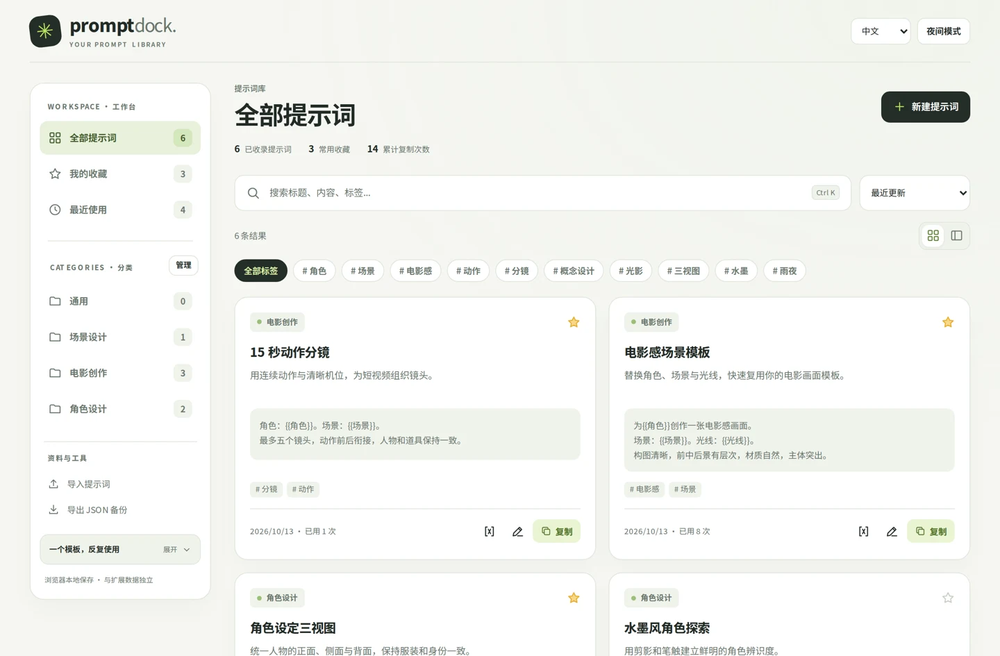
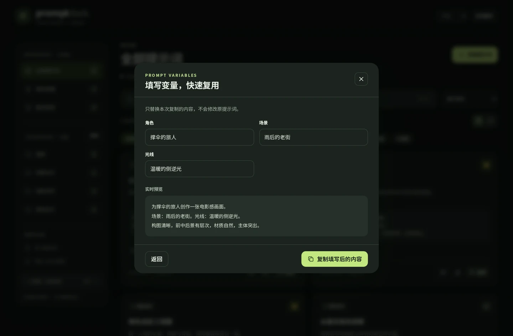

# PromptDock · 提示词仓

一个从 AI 影视创作中的真实需求出发设计的本地提示词管理扩展。保存常用模板，替换变量，在创作时快速调用。

**Manifest V3 · 原生 JavaScript · 中英双语 · 明暗主题 · 本地存储 · MIT**

[商店安装](https://microsoftedge.microsoft.com/addons/detail/mgjljnlkanbhnalfjoclalgoaagdielc) · [产品设计复盘](docs/CASE_STUDY.md) · [English](README.en.md) · [隐私说明](docs/PRIVACY.md)



> 图片来自同系列网页工作台的真实代码渲染，使用演示数据；网页布局与扩展小窗、侧边栏布局有所不同。仓库中的扩展版本为 **1.4.1**，首次使用只预置一条示例提示词。

## 为什么做这个产品

在 AI 影视创作中，角色、场景和光线经常变化，而一段提示词的结构可以反复使用。把模板分散放在聊天记录、文档和便签中，会增加寻找和修改的成本。PromptDock 把保存、检索、替换变量和复制放在同一个浏览器工具里。

## 可以做什么

| 功能 | 具体行为 |
| --- | --- |
| 提示词库 | 新建、编辑、删除、搜索、标签、收藏、最近使用与排序 |
| 自定义分类 | 创建、重命名、删除分类；删除后提示词移入「通用」 |
| 模板变量 | 识别 `{{主体}}` 等占位符，填写后预览和复制，保留原模板 |
| 多种入口 | 独立小窗、浏览器侧边栏、完整工作台、网页选中文字后右键保存 |
| 浮窗置顶 | 在支持 Document Picture-in-Picture 的浏览器中使用 |
| 数据迁移 | JSON 导入、导出与单条分享 |
| 界面偏好 | 中文／English、日间／夜间模式，保留本机选择 |



## 安装与使用

### 从商店安装

打开上方 Microsoft Edge 商店链接安装。若商店链接暂不可用，可以使用下面的本地加载方式。商店安装与源码加载的扩展身份可能不同，数据迁移请使用 JSON 导出／导入。

### 从源码加载

1. 在 GitHub 仓库选择 **Code → Download ZIP** 并解压，或克隆仓库。
2. 打开 `edge://extensions`，开启「开发人员模式」。
3. 选择「加载解压缩的扩展」，选中本仓库的 **extension** 文件夹。
4. 点击工具栏图标，打开 PromptDock 独立小窗。

代码无需编译，也无需安装 npm 依赖。主要面向 Edge；Manifest 声明 Chromium 116 为最低版本，但各浏览器对侧边栏、画中画和快捷键的支持不同。请以实际浏览器验证为准。

### 变量只需三步

1. 保存模板：`为{{主体}}创作电影感画面。场景：{{场景}}。光线：{{光线}}。`
2. 打开模板，选择「填写变量并复制」，输入本次内容。
3. 复制结果到生成平台使用。临时填写值不会自动覆盖模板，未填变量保留原样。

### 网页预览

直接打开 `extension/index.html`，或在项目目录运行 `python -m http.server 8080`，访问 `http://localhost:8080/extension/index.html`。网页模式与扩展的数据分别保存在各自存储空间，扩展专属入口不可用；浏览器限制存储时会提示仅临时保存。

## 数据与权限

当前版本没有模型 API、账号、云同步、遥测或远程脚本。扩展页面的 CSP 包含 `connect-src 'none'`，不申请网页域名权限，不注入网页内容脚本。用户主动复制、导出或把内容粘贴到其他服务时，由用户决定内容去向。

| 权限 | 用途 |
| --- | --- |
| `storage` | 保存提示词、分类和界面偏好 |
| `sidePanel` | 打开浏览器侧边栏 |
| `contextMenus` | 用户主动选中文字后，通过右键菜单保存 |

卸载、清理扩展存储或切换扩展身份可能丢失本机数据，请先导出备份。置顶依赖浏览器支持和用户点击授权，关闭来源小窗也会关闭附属画中画窗口。

## 源码结构

| 文件／目录 | 职责 |
| --- | --- |
| `extension/manifest.json` | 扩展声明、权限和本地化入口 |
| `extension/background.js` | 后台写入协调、右键摘录、窗口复用 |
| `extension/app.js` | 提示词、分类、变量和界面交互 |
| `extension/store.js` | 数据迁移、差量合并和冲突检测 |
| `extension/ui.js` | 语言与主题偏好 |
| `extension/floating.js` | 画中画 DOM 迁移与恢复 |
| `extension/privacy.js` | 清理旧版退役 API 设置，不读取密钥 |
| `tests/` | Node.js 内置测试，无第三方测试框架 |
| `docs/` | 产品复盘、隐私说明、展示图片 |

## 验证与打包

安装 Node.js 20 或更高版本后执行 `npm test`，或直接执行：

```sh
node --test tests/core.test.cjs tests/privacy.test.cjs tests/floating.test.cjs tests/windows.test.cjs tests/ui.test.cjs
```

2026-10-17：**66 项自动化测试通过**，覆盖数据冲突、导入转义、变量替换、窗口复用、浮窗恢复、语言主题与隐私边界。测试包含模拟浏览器环境，不等同于所有浏览器的端到端验证。本次开源整理保留 1.4.1 扩展代码，没有修改运行逻辑。

运行 `python scripts/package.py`，在 `dist/` 生成可加载扩展压缩包。开发贡献参见 [CONTRIBUTING.md](CONTRIBUTING.md)。

## 作者与项目范围

项目发起、需求定义、视觉与交互设计、体验迭代：**梁伊轩 / lalakii88**。代码实现、调试和部分文档使用 AI 辅助完成。该项目展示从创作痛点、交互设计到可运行产品的实践；不声称具备未验证的用户规模或商业效果。

本仓库公开扩展源码、通用演示素材、测试和文档，不包含用户提示词备份、账号凭据、商店后台资料或个人项目素材。

## 许可证

本仓库随附的代码、图标和演示图片按 [MIT License](LICENSE) 发布。使用者自行导入的提示词及其他素材，其权利仍属于各自权利人。MIT 许可证不表示官方背书，也不授予 Microsoft、Edge 等第三方品牌的使用权。
